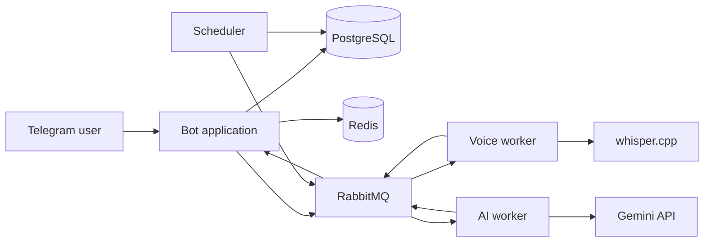

<div align="center">

# AI Manager

### A Telegram-first AI task manager for tasks, goals, voice capture, planning, and scheduled productivity analysis.

AI Manager turns private Telegram messages into structured tasks and goals, keeps
plans as pinned messages, derives a calendar from task deadlines, and uses Gemini
and whisper.cpp behind asynchronous workers.

[](https://www.python.org/)
[](https://docs.aiogram.dev/)
[](https://www.postgresql.org/)
[](https://redis.io/)
[](https://www.rabbitmq.com/)
[](https://ai.google.dev/)
[](https://docs.astral.sh/uv/)
[](https://docs.astral.sh/ruff/)

</div>

---

> [!CAUTION]
> This repository is an MVP, not a production-ready hosted service. It processes
> private Telegram content and payment events. Before deploying it for real users,
> review the limitations below, rotate any credentials ever used during development,
> restrict infrastructure to private networks, and configure backups, monitoring,
> retention, and secret management.

## What it does

| Capability | Description |
|---|---|
| Natural-language capture | Classifies private text messages as tasks, goals, plans, unsupported content, or a mixture. |
| Voice capture | Accepts voice messages up to 30 seconds, transcribes them with `whisper.cpp`, and sends the transcript to the same classifier. |
| Task and goal storage | Saves structured tasks and goals automatically and flags uncertain extracted fields for review. |
| Derived calendar | Builds `/calendar` from task deadlines instead of maintaining a duplicate calendar table. |
| Telegram-native plans | Pins plans in the chat and never stores plan text, media, transcripts, or a plan index in PostgreSQL. |
| Scheduled analysis | Queues day-3, weekly, monthly, and yearly productivity analysis at 08:00 in each user's IANA timezone. |
| Voice quotas | Uses Redis for atomic local-day quota reservations and PostgreSQL for durable usage records. |
| Telegram Stars | Creates recurring 30-day subscription invoices and activates access after a successful payment update. |
| Reliable messaging | Uses durable RabbitMQ messages, publisher confirms, an outbox, and idempotent consumers. |

## How it works



Incoming Telegram messages are routed in a strict order:

1. Supported slash commands are handled locally without Gemini.
2. Forwarded messages and original photos or videos are pinned immediately.
3. Accepted voice messages are quota-checked, transcribed, and classified.
4. Original text messages are classified.
5. Unsupported media receives a concise response and is not processed.

The RabbitMQ contracts are versioned (`transcription.request.v1`, `ai.request.v1`,
`analysis.request.v1`, and their result/failure counterparts). Messages carry a
validated audio basename rather than audio bytes or an arbitrary file path.

## Architecture

The repository is a `uv` workspace with four Python packages:

```text
Telegram update -> bot handlers -> PostgreSQL / outbox -> RabbitMQ
                                                       |          |
                                                       v          v
                                                 voice worker   AI worker
```

Compose runs the same application image as both the bot and the scheduler. Together
with PostgreSQL, Redis, RabbitMQ, the transcription worker, and the AI worker, this
preserves the six-component deployment topology without adding another service.

All database timestamps use UTC. User-visible dates, quota boundaries, and scheduled
analysis use the user's IANA timezone.

## Quick start with Docker

### Prerequisites

- [Docker](https://docs.docker.com/get-docker/) with Docker Compose
- A Telegram bot token from [BotFather](https://core.telegram.org/bots/features#botfather)
- A Gemini API key from [Google AI Studio](https://aistudio.google.com/app/apikey)
- Internet access while the images are built
- Enough disk space for the `whisper.cpp` small model and container images

### 1. Create the environment file

```bash
cp .env.example .env
```

Edit `.env` and replace every `replace-with-...` value. At minimum, set:

- `APP_BOT_TOKEN`
- `AI_GEMINI_API_KEY`
- `POSTGRES_PASSWORD` and the matching password inside `APP_DATABASE_URL`
- `RABBITMQ_PASSWORD` and the matching passwords inside all three RabbitMQ URLs

Keep `.env` local. It is ignored by Git and excluded from Docker build contexts.
Never put real tokens in `.env.example`, source code, screenshots, issues, or commits.

### 2. Download the speech model

```bash
mkdir -p models
curl -L --fail \
  -o models/ggml-small.bin \
  https://huggingface.co/ggerganov/whisper.cpp/resolve/main/ggml-small.bin
```

Model binaries under `models/` are ignored by Git. To use a model stored elsewhere,
set `WHISPER_MODEL_PATH` in `.env` to that host path.

### 3. Build and start the stack

```bash
docker compose up --build -d
docker compose logs -f app scheduler voice ai
```

The app container applies Alembic migrations before it starts polling Telegram.
Stop the stack with:

```bash
docker compose down
```

Named volumes are preserved. Add `--volumes` only when you intentionally want to
delete PostgreSQL, Redis, RabbitMQ, and queued voice data.

## Telegram commands

| Command | Purpose |
|---|---|
| `/tasks` | Show open tasks due today in the user's timezone. |
| `/calendar` | Group future tasks into tomorrow, this week, and later. |
| `/goals` | Show active goals. |
| `/subscribe` | Create a recurring 30-day Telegram Stars subscription invoice. |

The MVP only handles private chats. It does not silently process groups or channels.

## Voice pipeline

1. The bot rejects audio longer than 30 seconds before download.
2. It atomically reserves the user's local-day quota in Redis and records the event
   in PostgreSQL.
3. The accepted file is written to the shared `voice-files` volume, while an outbox
   job is committed in the same database transaction.
4. The voice worker converts the input to 16 kHz mono WAV with FFmpeg and transcribes
   it with `whisper-cli`.
5. After a confirmed downstream publish, the worker deletes both local audio files.
6. Infrastructure or transcription failures refund the reservation exactly once.
   Successfully transcribed messages count even when classification is unsupported.

The limits are five accepted messages on registration day, three on later free days,
twenty for paid users, and unlimited use for configured Telegram IDs.

## Configuration

`.env.example` documents every supported variable. Values prefixed with `APP_`,
`VOICE_`, and `AI_` are read by their respective processes.

| Variable | Required | Purpose |
|---|---:|---|
| `POSTGRES_PASSWORD` | Yes | Local Compose PostgreSQL password. Must match `APP_DATABASE_URL`. |
| `RABBITMQ_PASSWORD` | Yes | Local Compose RabbitMQ password. Must match the three RabbitMQ URLs. |
| `APP_BOT_TOKEN` | Yes | Telegram bot token. Treat it as a secret. |
| `APP_DATABASE_URL` | Yes | Async SQLAlchemy PostgreSQL URL. |
| `APP_REDIS_URL` | Yes | Redis URL used for quotas and short-lived state. |
| `APP_RABBITMQ_URL` | Yes | RabbitMQ URL used by the bot and scheduler. |
| `APP_VOICE_DIRECTORY` | No | Shared directory for short-lived downloaded audio. |
| `APP_STARS_PRICE` | No | Positive whole-Star price for a 30-day subscription. |
| `APP_VOICE_WHITELIST` | No | Comma-separated Telegram user IDs with unlimited voice use. |
| `APP_LOG_LEVEL` | No | Python log level; defaults to `INFO`. |
| `VOICE_RABBITMQ_URL` | Yes | RabbitMQ URL used by the transcription worker. |
| `VOICE_VOICE_DIRECTORY` | No | Must point to the same shared audio volume as the app. |
| `VOICE_WHISPER_BINARY` | No | Path to `whisper-cli` inside the voice container. |
| `VOICE_WHISPER_MODEL` | No | Model path visible inside the voice container. |
| `VOICE_LANGUAGE` | No | Whisper language code, or `auto` for detection. |
| `AI_RABBITMQ_URL` | Yes | RabbitMQ URL used by the AI worker. |
| `AI_GEMINI_API_KEY` | Yes | Gemini API key. Treat it as a secret. |
| `AI_GEMINI_MODEL` | No | Gemini model identifier available to the configured account. |
| `WHISPER_MODEL_PATH` | No | Host path mounted into the voice container. |

If a credential has ever been committed, deleting the file is not enough: revoke or
rotate the credential, then clean the Git history before publishing.

## Running without Docker

Install [uv](https://docs.astral.sh/uv/), PostgreSQL 17, Redis 7, RabbitMQ 4,
FFmpeg, and `whisper-cli`. Make those services reachable using the URLs in `.env`,
then install the workspace:

```bash
uv sync --all-packages
uv run alembic -c services/app/alembic.ini upgrade head
```

Run each process in its own terminal:

```bash
uv run ai-manager-bot
uv run ai-manager-scheduler
uv run ai-manager-voice
uv run ai-manager-ai
```

The voice worker defaults target container paths. Override `VOICE_WHISPER_BINARY`,
`VOICE_WHISPER_MODEL`, and `VOICE_VOICE_DIRECTORY` for a native installation.

## Project structure

```text
.
├── docker/voice/             whisper.cpp worker image
├── models/                   local model files (ignored by Git)
├── packages/contracts/       versioned Pydantic RabbitMQ contracts
├── services/ai/              Gemini classification and analysis worker
├── services/app/             bot, persistence, payments, scheduler, and migrations
├── services/voice/           FFmpeg and whisper.cpp transcription worker
├── compose.yaml              local six-component stack
├── Dockerfile                application and AI worker image
├── pyproject.toml            workspace and shared tool configuration
└── uv.lock                   reproducible dependency lockfile
```

## Development

Install locked dependencies and run the complete quality gate:

```bash
uv sync --all-packages
uv run ruff format --check .
uv run ruff check .
uv run pytest
```

Apply formatting with `uv run ruff format .`. Schema changes must be made through
Alembic migrations; the application does not call `create_all`.

## Security and privacy

- `.env`, private keys, local databases, caches, IDE metadata, downloaded voice files,
  and Whisper model binaries are excluded from Git.
- Raw voice audio is short-lived and is deleted after successful downstream delivery.
- Plans are represented only by pinned Telegram messages and are never persisted.
- Logs should contain identifiers and failure metadata, not message or plan contents.
- Use a secret manager and private networking outside local development.
- Report vulnerabilities using the private process in [SECURITY.md](SECURITY.md).

Before the first public push, run the checks in the
[publishing checklist](#publishing-checklist) and rotate any development credentials
that have been copied outside your machine.

## Current limitations

- Onboarding fields are represented in the data model, but the full guided onboarding
  conversation is not implemented yet.
- The payment path handles successful purchase updates; complete renewal,
  cancellation, expiration, and refund lifecycle handling still needs hardening.
- The bot uses long polling and has no HTTP health or readiness endpoint.
- The scheduler scans once per minute and does not yet use a distributed scheduler lock.
- Broker consumers retry failures but do not have a dedicated dead-letter workflow.
- Operational monitoring, backups, deployment manifests, and production secret
  management are outside this repository.

## Publishing checklist

- [ ] Confirm `git status --ignored` shows `.env`, model binaries, caches, and IDE files as ignored.
- [ ] Run the quality gate from the Development section.
- [ ] Scan the full Git history with a secret scanner such as `gitleaks` or GitHub secret scanning.
- [ ] Revoke any token or password that may have appeared in a previous commit or shared log.
- [ ] Choose and add a license if you want others to copy, modify, or redistribute the project.
- [ ] Review repository visibility, branch protection, Actions permissions, and Dependabot settings.
- [ ] Push from a clean branch and inspect the repository as a signed-out GitHub visitor.

## License

No license has been selected. Public visibility alone does not grant permission to
copy, modify, or redistribute the code. Add a license before accepting external use
or contributions.
